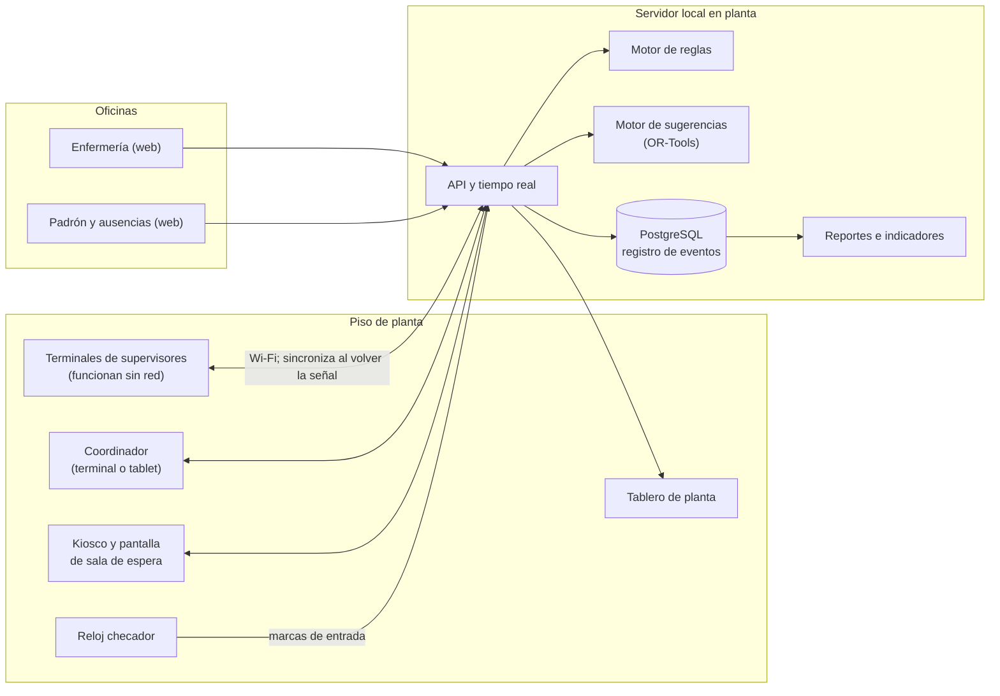
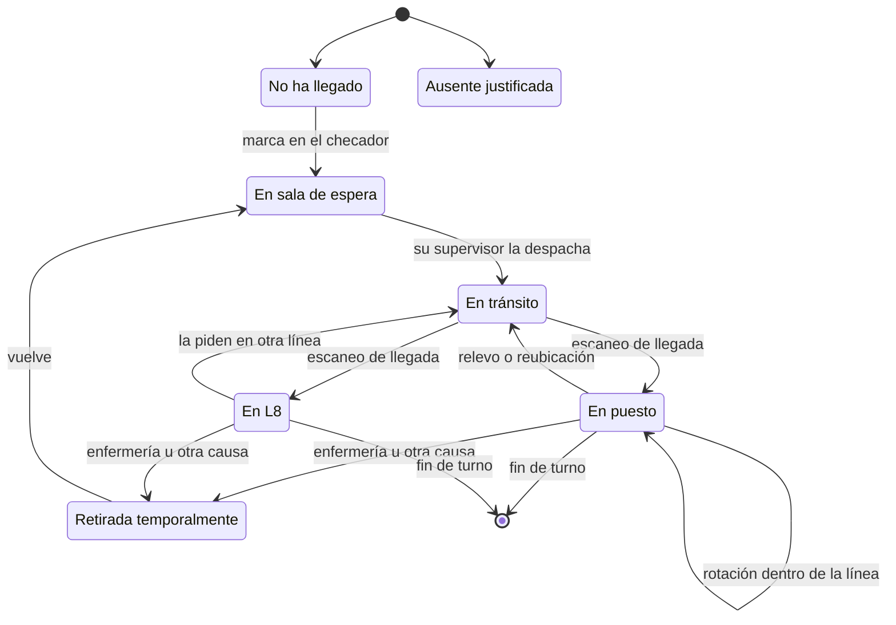
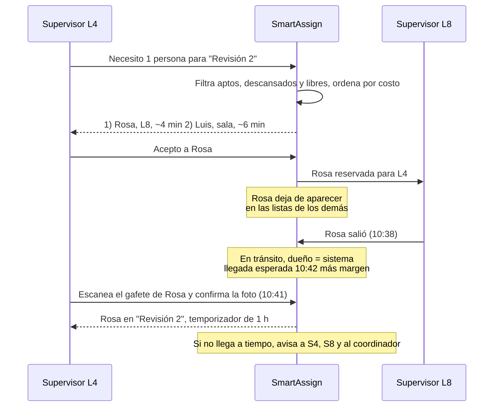

# SmartAssign: propuesta de solución para el reparto de personal

Responde al documento *Reparto de personal en una planta de envasado: el problema*. Octubre de 2026.

> **Nota:** esta es la propuesta inicial, de alcance completo. El alcance se redujo a la herramienta del supervisor de línea; lo vigente está en `Diseno_herramienta_supervisor.md`.

## 1. Resumen

A la planta no le faltan operarios. Le falta información compartida y coordinación. El estado del turno (quién está dónde, qué puestos existen hoy, quién cubre a quién, cuánto lleva cada persona en su puesto) vive en la memoria de seis personas que caminan. Las reglas que deberían guiar cada decisión (calificación, restricciones médicas, tiempos de desgaste) están en planillas y carpetas que no llegan al piso.

La propuesta es **SmartAssign**, un sistema de apoyo a la decisión para el turno con cinco piezas:

1. **Estado vivo de la planta.** Cada persona, cada puesto y cada línea con su situación real, actualizada en el momento.
2. **Motor de reglas.** Bloquea lo que no se puede hacer (puesto prohibido por Enfermería, categoría que no corresponde, volver antes de recuperarse) y avisa lo que no conviene.
3. **Motor de sugerencias.** Propone a quién mover, desde dónde y en qué orden, mirando la planta entera y la prioridad de las líneas.
4. **Terminales de mano con lector de gafete** para supervisores y coordinador, que funcionan sin red.
5. **Registro automático del turno.** Paros, lotes, desperdicio por causa, eficiencia, movimientos y tiempos de traslado.

Tres decisiones de diseño sostienen todo lo demás:

- **Cada persona tiene un único dueño en cada momento**: la coordinación, una línea, o "en tránsito". Solo el dueño puede moverla. Eso elimina las dobles reservas y permite que cada supervisor opere sin red sobre su propia gente sin generar conflictos.
- **Todo movimiento entre líneas es una transacción**: salida, tránsito con hora esperada de llegada, y llegada confirmada con el escaneo del gafete. Si alguien no llega, salta una alerta.
- **La L8 y la sala de espera son el pulmón de la planta.** Los huecos se cubren desde ahí y no sacando gente de una línea para tapar otra. Eso corta el efecto dominó y permite rotar sin dejar puestos vacíos.

El sistema propone y bloquea lo inseguro. El supervisor y el coordinador deciden.

## 2. Diagnóstico

### 2.1 Tres causas raíz detrás de las diez fallas

| Causa raíz | Qué significa | Fallas que explica (sección 8 del documento) |
|---|---|---|
| **A. No existe un estado compartido del turno** | Nadie, ni siquiera el coordinador, tiene una imagen confiable de dónde está cada persona y qué puestos existen hoy | 1 trayecto, 2 doble reserva, 8 arranque, 9 titulares, 10 sin registro |
| **B. Las reglas no llegan al momento de decidir** | Calificaciones sin registrar, restricciones en una carpeta, tiempos en una planilla, identidad basada en un número impreso | 4 restricciones, 5 gafetes, 6 desgaste |
| **C. Cada decisión se toma mirando una sola línea** | El supervisor resuelve su hueco con lo que tiene a mano, sin ver el costo que le genera a otra línea | 3 dominó, 7 gente parada en paro, 8 arranque |

### 2.2 Lo que dicen los números del documento

- **La mano de obra general alcanza.** Hay unos 120 operarios para 67 puestos rotativos. Aun descontando ausencias quedan decenas de personas fuera de los puestos rotativos, que hoy van a la L8 o esperan. Ese excedente es justamente lo que permite tener relevos sin dejar puestos vacíos. Lo que falta es control sobre él.
- **La escasez técnica es estructural.** Hay 26 operadores y 3 averieros, 29 técnicos en total, para 31 puestos fijos. Si todos los puestos fijos existieran a la vez, faltarían técnicos aun con asistencia perfecta, y cada Operador B que cubre una máquina deja de estar disponible para la siguiente. El sistema puede administrar mejor a los B, pero no puede crearlos. Lo que sí hará es medir cuántas veces faltó un B y dónde, que es el dato para dimensionar la formación de C a B.
- **La rotación no se puede llevar de memoria.** Un puesto de 1 h genera hasta 8 relevos en un turno de 8 h. Con 67 puestos rotativos de 1 a 8 h, cada uno con su propio tiempo de recuperación, el turno acumula varias decenas de relevos.

### 2.3 Observaciones que condicionan el diseño

1. **El Operador B decide la cobertura de las máquinas, y hoy no se sabe quiénes son.** Es el primer dato a levantar. Sin él ningún sistema puede ayudar con las máquinas.
2. **Rotar sin holgura siempre abre un hueco.** Si desde el arranque todos los rotativos están ocupados, cada relevo deja un puesto vacío un momento. La salida es tener un relevista que entra antes de que alguien salga. La L8 tiene el perfil exacto para eso: trabajo permanente y nunca urgente. La propuesta la convierte formalmente en la reserva productiva de la planta.
3. **"Hoy no existe" es un tercer estado del puesto**, distinto de libre y de ocupado. Si el sistema no lo modela, repite el error de hoy. Se deriva del producto que hace la línea.
4. **Prioridad y cercanía son parámetros independientes.** La prioridad cambia en medio del turno; el motor la toma como dato vivo. La tabla de cercanía sirve de costo de traslado hasta tener tiempos reales, y el propio sistema los medirá en cada movimiento confirmado.
5. **El supervisor no necesita conocer la restricción médica, solo si la persona es apta para el puesto.** Eso resuelve a la vez la privacidad y la utilidad.
6. **El entorno no es un detalle.** Una mano libre, iluminación variable y red inestable obligan a un hardware y una arquitectura específicos (sección 9).
7. **Apoyo a la decisión, no piloto automático.** El supervisor sabe cosas que el sistema no sabe: quién está aprendiendo, quién no se lleva con quién, qué máquina viene fallando. El sistema propone con razones y el supervisor confirma con un toque.

### 2.4 Lo que falta saber y cómo se cierra

| Vacío (sección 10) | Cómo se cierra | Quién | Cuándo |
|---|---|---|---|
| No se sabe quiénes son B y C | Taller de una hora con supervisores para clasificar a los 26 operadores, validado por el coordinador | Coordinador y supervisores | Fase 0 |
| Qué puestos necesita cada producto | Plantilla producto → puestos para los productos más frecuentes. Después, el sistema aprende del uso real y propone completar las plantillas | Supervisores | Fase 0, se completa en Fase 1 |
| Restricciones médicas en papel | Catálogo cerrado de esfuerzos prohibidos definido por Enfermería, carga con vigencia y consentimiento de cada persona | Enfermería y Legal | Fase 0 |
| Tiempos de traslado no medidos | Media jornada con cronómetro para los recorridos más usados. Luego el sistema mide cada traslado confirmado y reemplaza la estimación | Un analista | Fase 0, se refina solo |
| L3, L5, L7, L9 y L10 sin datos | El modelo es genérico: sumar una línea es cargar su configuración | Coordinador | Cuando se activen |

## 3. Cómo responde a cada falla

| # | Falla | Qué hace SmartAssign |
|---|---|---|
| 1 | Gente que se pierde en el trayecto | Cada traslado tiene salida registrada, hora esperada de llegada y confirmación por escaneo en destino. Si no llega a tiempo, avisa a ambos supervisores y al coordinador |
| 2 | Dos supervisores cuentan con la misma persona | Dueño único: al reservar a alguien desaparece de la lista de los demás al instante |
| 3 | Efecto dominó | Los pedidos se resuelven primero desde la sala, la L8 o una línea en paro. Sacar a alguien de una línea activa exige aprobación del coordinador, muestra el hueco que deja y nunca dispara un segundo salto automático |
| 4 | Restricciones que no llegan a quien decide | Enfermería las registra; el sistema bloquea la asignación y al supervisor solo le muestra "no apto para este puesto" |
| 5 | Gafetes cambiados | Gafete con código QR único. Al escanearlo aparece la foto en grande para confirmar que es la persona |
| 6 | Desgaste que nadie ve | Temporizador por persona y puesto, aviso antes del límite, bloqueo del regreso antes de la recuperación (incluye turnos anteriores) y marca de doble turno |
| 7 | Gente parada durante un paro | Al registrar el paro, los rotativos quedan disponibles y el sistema propone dónde llevarlos según prioridad y distancia, si el paro dura lo suficiente para que valga la caminata |
| 8 | Arranque desordenado | El plan del día ya asigna a cada persona a una línea. La pantalla de la sala muestra los grupos y el orden de salida. Cada llegada al puesto se confirma por escaneo |
| 9 | Titulares que vuelven | El sistema guarda cada cobertura (máquina, titular, suplente y de dónde vino). Cuando el titular vuelve, propone deshacerla en orden |
| 10 | El turno no deja registro | Todo queda como evento con hora y autor. El reporte de cierre y la eficiencia se calculan solos |

## 4. Visión general

| Usuario | Herramienta | Para qué |
|---|---|---|
| Supervisor | Terminal Android rugerizada con lector | Su línea: recibir, asignar, relevar, pedir y enviar gente, paros, lotes, cierre |
| Coordinador | Terminal o tablet, más el tablero de planta | Plan del día, prioridades, vista de las 10 líneas, aprobaciones, padrón |
| Enfermería | Web en PC | Restricciones con vigencia, retiros temporales |
| Personal | Pantalla de sala de espera (no necesita dispositivo) | Ver a qué línea va y cuándo sale su grupo |

## 5. Modelo del dominio

### 5.1 Entidades

| Entidad | Datos clave |
|---|---|
| Persona | Gafete (número impreso y código QR), foto, categoría (A, B, C, averiero, operario, liderazgo), habilidades extra (para liderazgo que puede cubrir), línea habitual, sexo |
| Esfuerzo | Catálogo cerrado definido por Enfermería: cargar más de cierto peso, estar de pie mucho tiempo, movimientos repetitivos de muñeca, flexión de tronco, etc. |
| Restricción | Persona, esfuerzo prohibido, vigente desde y hasta, emitida por. Nunca un diagnóstico. Solo la ve Enfermería |
| Línea | Prioridad del día (editable en el turno), estado, supervisor asignado |
| Producto | Ritmo teórico, plantilla de puestos que necesita |
| Puesto | Línea, tipo (fijo de A, fijo de averiero, fijo de C, rotativo), titular, tiempo en el puesto, tiempo de recuperación, esfuerzos que exige, sexo preferente |
| Plan del turno | Líneas activas, producto por línea, supervisor por línea, asignación inicial |
| Asignación | Persona, puesto, inicio, fin, motivo, quién decidió. De este historial salen desgaste y recuperación |
| Cobertura | Máquina, titular ausente, suplente y puesto del que salió el suplente |
| Movimiento | Persona, origen, destino, solicitado por, salida, llegada, estado |
| Paro | Línea, inicio, fin, causa (mecánica, eléctrica, calidad, falta de material, otra) |
| Lote | Línea, producto, inicio, fin, producción, daño de origen, daño de proceso |

Todo cambio se guarda como un **evento inmutable** con hora, autor y dispositivo. El estado actual se deriva de los eventos, y los reportes también. Eso da la auditoría completa sin trabajo extra.

### 5.2 Estados de la persona

Son los siete del documento, más un dato que hoy no existe: **quién es su dueño** en cada momento.

| Estado | Dueño |
|---|---|
| En sala de espera | La línea a la que el plan del día la asignó, o la coordinación si no tiene línea |
| En puesto o en L8 | El supervisor de esa línea |
| En tránsito | El sistema. Nadie la puede tocar hasta que llegue |
| Retirada o ausente | Nadie. No aparece como candidata |

### 5.3 Estados del puesto en el turno

| Estado | Significado |
|---|---|
| No existe hoy | El producto actual no lo necesita. No cuenta como libre ni como ocupado |
| Vacante | Existe y no tiene a nadie |
| Reservado | Alguien va en camino |
| Ocupado por titular | Situación normal de un puesto fijo |
| Cubierto por suplente | Un puesto fijo lo ocupa quien no es titular; queda registrada la cobertura |
| Sin tarea | La línea está en paro: la persona sigue asignada, pero se la puede reubicar |

Los estados de línea son los del documento: inactiva, en arranque, en producción, en paro, en limpieza.

### 5.4 Reglas duras y blandas

**Duras: el sistema no deja asignar.**

1. La categoría corresponde al tipo de puesto (tabla "Quién puede ocupar cada puesto" del documento). A y averieros no pasan a rotativos.
2. Ningún esfuerzo que exige el puesto está prohibido para la persona. **No admite excepción desde el sistema**: solo Enfermería puede cambiar una restricción.
3. No vuelve a un puesto antes de su tiempo de recuperación, contando turnos y días anteriores. Ejemplo: girar botellas (2 h, recuperación 24 h) de 8:00 a 10:00 del lunes la habilita de nuevo el martes a las 10:00, así que no puede repetir el martes a las 8:00. Solo el coordinador puede exceptuarla, con motivo registrado.
4. El puesto existe hoy.
5. Quien asigna es el dueño de la persona.

**Blandas: el sistema avisa, penaliza en las sugerencias y deja pasar con un toque, que queda registrado.**

- Sexo preferente del puesto (es preferencia ergonómica, no prohibición).
- Línea habitual.
- Distancia del traslado.
- Doble turno en puestos exigentes.
- Liderazgo cubriendo un puesto: solo en falta grave y con autorización del coordinador.

**Escalonadas: el tiempo en el puesto.** No se puede bloquear (no hay forma de obligar a que llegue un relevo), así que escala: aviso amarillo con anticipación suficiente para que el relevo llegue, rojo al cumplirse el límite, y aviso al coordinador si se excede.

## 6. Un turno con SmartAssign

### 6.1 El día anterior

1. El coordinador marca las líneas activas, el producto de cada una y su supervisor.
2. El sistema despliega los puestos que existen según la plantilla de cada producto.
3. Calcula la oferta: padrón menos ausencias ya conocidas.
4. Muestra el balance por categoría y por línea, en orden de prioridad. Por ejemplo: "Mañana faltan 2 técnicos de máquina; sin un B adicional, quedarán sin cubrir dos máquinas de L6".
5. Propone la asignación inicial. El coordinador la ajusta y la publica.
6. El plan publicado se puede imprimir como respaldo si algo falla.

### 6.2 El arranque

1. Cada persona marca en el checador, o escanea su gafete en el kiosco de la sala si el checador no se puede integrar. Pasa a "en sala" y su dueño es la línea del plan.
2. La pantalla de la sala muestra los grupos por línea con nombres y hora de salida. Las salidas pueden escalonarse por prioridad para no congestionar los pasillos.
3. Diez minutos antes del arranque (configurable), si un titular de máquina no marcó, el sistema propone el B que menos daño causa al salir de donde está y quién rellena el puesto de ese B.
4. El supervisor junta a su grupo con la lista en la terminal. En la línea escanea a cada persona en su puesto: pasa a "en puesto" y arranca su temporizador.
5. Si alguien del grupo no llega en el tiempo esperado, salta un aviso.
6. Quien llega tarde entra a la sala, y el sistema propone dónde hace más falta.

### 6.3 Durante el turno: desgaste y rotación

- Cada persona en un puesto rotativo lleva una barra de tiempo (verde, amarilla, roja) visible en la terminal de su supervisor.
- El aviso de relevo llega con anticipación igual al tiempo de traslado del relevista más un margen, para que el relevo llegue antes de que alguien salga.
- **Relevo en cadena.** Para que rotar no abra huecos, el sistema arma la secuencia y el supervisor la ejecuta paso a paso, confirmando cada uno con un escaneo:
  1. Rosa (desde L8) llega a Revisión 1.
  2. Ana deja Revisión 1 y pasa a Girar botellas 2.
  3. Pedro deja Girar botellas 2 y va a L8 a recuperarse.

  El único hueco dura los segundos que tarda una persona en moverse dentro de la misma línea.
- **Plan de rotación (Fase 2).** El motor calcula las rotaciones de las próximas horas para cada línea respetando tiempos y recuperaciones, reparte los puestos pesados de forma pareja y se recalcula ante cada imprevisto.
- **Doble turno.** El checador lo detecta solo. La persona queda marcada, sus tiempos en el puesto se acortan según un factor que definen Enfermería y Seguridad e Higiene, y el motor evita darle los puestos más exigentes.

### 6.4 Pedir y enviar gente entre líneas

1. El supervisor toca "Necesito gente" y elige el puesto.
2. El sistema filtra a los aptos, descansados y disponibles, y los ordena por costo. El orden de búsqueda es:
   1. sala de espera;
   2. L8 (sus salidas se aprueban por defecto; el supervisor de L8 solo confirma la salida);
   3. líneas en paro o en limpieza;
   4. excedentes de otras líneas;
   5. un puesto ocupado de una línea de menor prioridad. Este último caso exige aprobación del coordinador y muestra el hueco que va a dejar.
3. Cada candidato aparece con sus razones: "Rosa · L8 · unos 4 min · apta · lleva 20 min descansando".
4. Al aceptar, la persona queda reservada y deja de figurar como candidata en las demás líneas.
5. Traslado transaccional (sección 7.1).

### 6.5 Imprevistos

| Evento | Qué registra el supervisor | Qué hace el sistema |
|---|---|---|
| Paro | Toca "Paro", elige la causa y estima la duración | Los fijos siguen (son quienes reparan). Los rotativos pasan a "sin tarea". Si la duración estimada supera ida y vuelta más un umbral, propone al coordinador llevarlos a huecos de otras líneas o a L8. Al terminar el paro, propone el regreso. Los minutos quedan para la eficiencia |
| Cambio de producto | Elige el nuevo producto | Calcula qué puestos aparecen y cuáles dejan de existir. Propone pasar a la gente de los puestos que desaparecen a los nuevos si es apta, y libera el sobrante hacia L8 o hacia huecos |
| Un titular se va | Enfermería o el supervisor lo marca como retirado | La máquina queda vacante. Propone el B que menos daño causa y quién rellena el puesto que deja ese B. Registra la cobertura |
| Un titular vuelve | Se escanea su gafete | Muestra la cobertura vigente y propone deshacerla: titular a su máquina, el B a su puesto anterior o adonde más falte, quien rellenaba vuelve a L8 |
| Cambio de prioridades | El coordinador reordena las líneas | Recalcula sugerencias. No mueve a nadie por su cuenta |
| Falta grave sin técnicos | El coordinador autoriza | Habilita a una persona de liderazgo calificada para ese puesto y lo registra |

### 6.6 Cierre de lote y de turno

- **Lote:** producción, daño de origen y daño de proceso, en tres campos numéricos. El daño de origen alimenta un reporte para logística y proveedores; el de proceso, uno para mantenimiento con la máquina asociada.
- **Eficiencia**, con la fórmula de la planta: producción real ÷ (tiempo efectivo de marcha × ritmo teórico del producto), donde el tiempo efectivo es el transcurrido menos los paros registrados. Se calcula por lote y acumulada, y se ve durante el turno, no solo al final.
- **Turno:** el reporte se arma solo con paros por causa y minutos, lotes, eficiencia, coberturas, relevos tardíos, movimientos y tiempos de traslado, y avisos no atendidos. El supervisor lo revisa, corrige lo que haga falta y lo cierra con un toque.

## 7. Piezas técnicas clave

### 7.1 Dueño único y movimientos transaccionales

Cada traslado confirmado deja una muestra de tiempo real entre dos líneas. Con unas semanas de uso, la mediana de esas muestras reemplaza a la tabla de cercanía como costo de traslado.

### 7.2 Funcionamiento sin red

La red de la planta tiene zonas muertas, así que la terminal guarda una copia local y sincroniza al recuperar señal. El modelo de dueño único es lo que hace esto seguro: si solo el supervisor de L4 puede mover a la gente de L4, lo que haga sin red no choca con nadie.

| Operación | ¿Funciona sin red? |
|---|---|
| Asignar y rotar a su propia gente dentro de la línea | Sí. Se sincroniza después |
| Registrar paros, lotes y desperdicio | Sí |
| Temporizadores y avisos de desgaste | Sí. Corren en la terminal |
| Validar aptitud | Sí, con la tabla apto/no apto descargada al inicio del turno |
| Recibir a alguien cuyo traslado ya estaba confirmado | Sí. La llegada se sincroniza después |
| Pedir o enviar gente a otra línea | No. Queda "pendiente" hasta que el servidor lo confirme, y la persona no se mueve antes |

Si el coordinador mueve a alguien mientras su supervisor estaba sin red, gana el servidor: al reconectar, la terminal recibe el cambio y marca para revisión lo que se hubiera hecho con esa persona en ese lapso.

### 7.3 Motor de reglas

- Un único paquete de reglas, el mismo en el servidor y en la terminal, para que una asignación valga lo mismo con red o sin ella.
- El servidor precalcula una **tabla de aptitud** (persona × puesto: apto o no apto) y la manda a cada terminal. La terminal nunca recibe restricciones ni esfuerzos, solo el resultado.
- Cada bloqueo y cada excepción quedan registrados. Las asignaciones inseguras que se evitaron también son un indicador.

### 7.4 Motor de sugerencias

Es un problema de asignación con restricciones, chico para los estándares de un solver: unas 160 personas y unos 100 puestos. Se resuelve con **Google OR-Tools (CP-SAT)** en tiempos del orden de un segundo, así que puede recalcularse ante cada evento.

- **Variables:** asignar o no a la persona *p* al puesto *j*. Solo se crean para los pares que cumplen las reglas duras.
- **Restricciones:** a lo sumo una persona por puesto y un puesto por persona; el titular presente ocupa su máquina; tiempos en el puesto y recuperaciones.
- **Objetivo, en orden de importancia:**
  1. cubrir las máquinas (fijos de A y de averiero) siguiendo la prioridad de líneas;
  2. cubrir los rotativos siguiendo la prioridad;
  3. mover a la menor cantidad posible de gente que ya está trabajando, y nunca encadenar huecos sin aprobación;
  4. minimizar la caminata;
  5. respetar las preferencias blandas;
  6. repartir a los Operadores B para que haya uno cerca de cada grupo de máquinas críticas.

Tres modos de uso:

| Modo | Cuándo | Qué entrega |
|---|---|---|
| Asignación inicial | El día anterior y en el arranque | Quién va a qué línea y puesto |
| Reubicación | Pedido de gente, paro, titular que se va o vuelve, cambio de producto | Las 3 mejores opciones, con razones y el costo de cada una |
| Plan de rotación | Continuo, con un horizonte de 2 a 3 horas | La secuencia de relevos de cada línea |

En la Fase 1 las sugerencias se calculan con reglas simples (ordenar candidatos por aptitud, descanso y cercanía). El optimizador entra en la Fase 2, cuando ya hay datos reales para calibrarlo.

## 8. Identidad, privacidad y datos médicos

**Identidad.**

- Reimprimir los gafetes con un código QR único que no sea el número visible. Un gafete perdido se anula y se emite otro.
- Al escanear aparece la foto de la persona en grande, y el supervisor confirma que coincide. Así un gafete prestado se detecta en el momento.
- Si el checador puede ser biométrico (huella o rostro, en un punto con buena luz), la identidad queda validada también al entrar.

**Datos médicos.**

- Solo se registran esfuerzos prohibidos de un catálogo cerrado, con fecha de vigencia. Nunca diagnósticos. Las restricciones temporales vencen solas.
- Solo Enfermería ve y edita las restricciones. El resto del sistema solo ve "apto" o "no apto" para un puesto concreto.
- Cifrado en reposo, registro de cada acceso y política de conservación.
- La planta está en Nicaragua, según el formato de cédula e INSS de la planilla del proyecto anterior (una primera versión de este documento suponía México). Los datos de salud son datos sensibles bajo la Ley 787 de Protección de Datos Personales, así que conviene que Legal valide el consentimiento antes de la Fase 1.

**Permisos por rol.**

| Rol | Ve | Puede |
|---|---|---|
| Coordinador | Las 10 líneas, el padrón, apto/no apto, ausencias por tipo general | Planificar, cambiar prioridades, mover a cualquiera, aprobar excepciones a reglas blandas, a la recuperación y a la calificación en falta grave |
| Supervisor | Su línea, su gente y los candidatos con apto/no apto | Asignar, relevar, pedir, enviar, registrar paros y lotes, cerrar el turno |
| Enfermería | Restricciones | Registrar y retirar restricciones, retirar temporalmente a una persona |
| Administración | Padrón, categorías, ausencias | Mantener los datos maestros |
| Dirección | Indicadores agregados | Consultar |

**Comunicación con el personal.** El sistema registra asignaciones confirmadas con un escaneo; no rastrea ubicación por GPS ni por balizas. Conviene decirlo explícitamente al personal y, si existe, al sindicato o la comisión mixta antes del piloto.

## 9. Hardware, interfaz y red

**Equipos.**

| Equipo | Cantidad orientativa | Requisitos |
|---|---|---|
| Terminal Android rugerizada con lector 1D/2D (familias como Zebra TC2x o Honeywell CT30/CT40) | 8: 5 supervisores, 1 coordinador, 2 de repuesto | Botón de escaneo lateral para usar con el pulgar, resistente a caídas y polvo, pantalla legible con mucha luz, batería para el turno completo (mejor si es intercambiable), correa de mano |
| Tablet como kiosco en la sala | 1 | Escaneo de llegada si el checador no se puede integrar |
| Pantallas | 2: sala de espera y coordinación | TV comercial con un equipo pequeño o navegador integrado |
| Gafetes reimpresos con QR | 164 y reposición | QR antes que NFC: más barato y lo lee el mismo lector |
| Servidor local | 1, con UPS y respaldo diario fuera de la planta | La operación no depende de internet |

**Interfaz para una mano y luz variable.**

- Las acciones frecuentes al alcance del pulgar, en la parte baja de la pantalla, con botones grandes que se puedan usar con guantes.
- Tres toques como máximo para asignar, relevar o registrar un paro.
- Sin escritura: listas, escaneo y teclado numérico grande.
- Alto contraste. El color siempre va acompañado de un ícono o texto.
- Vibraciones distintas por tipo de aviso, porque con el ruido de la planta el sonido no sirve.

**Red.** Un estudio de cobertura Wi-Fi y puntos de acceso en las zonas muertas mejoran la experiencia, pero el sistema no depende de ellos (sección 7.2).

## 10. Arquitectura de software

| Capa | Tecnología recomendada | Por qué |
|---|---|---|
| App del supervisor | React Native para Android, con SQLite local y cola de sincronización | Funciona sin red, se integra con el lector y la vibración |
| Consola del coordinador, Enfermería, pantallas | React (web) | Un solo navegador sirve en tablet, PC y TV |
| Servidor | Node.js con TypeScript, PostgreSQL, WebSockets para tiempo real | Volumen chico (miles de eventos por turno), fácil de operar |
| Reglas | Paquete TypeScript compartido entre servidor y app | La misma regla da el mismo resultado con y sin red |
| Motor de sugerencias | Python con OR-Tools (CP-SAT), como servicio interno | Herramienta estándar y gratuita para asignación con restricciones |
| Despliegue | Contenedores Docker en el servidor local | Instalación y actualización repetibles |
| Integraciones | Checador (API, base de datos o exportación periódica); más adelante contadores de máquina por OPC UA | Llegadas automáticas y producción real sin captura manual |

## 11. Indicadores

Se mide una **línea base** durante dos semanas antes del piloto, por observación y con el papel actual. Sin ella no habrá forma de demostrar la mejora.

| Pérdida del documento | Indicador | Meta orientativa |
|---|---|---|
| Nadie sabe dónde está cada persona | Traslados no confirmados; tiempo medio de traslado por par de líneas | Ningún traslado sin cerrar al final del turno |
| Gente en puestos prohibidos | Asignaciones que violan una restricción; bloqueos evitados | Cero violaciones |
| Desgaste sin control | Relevos a tiempo; regresos antes de la recuperación | Más del 90 % a tiempo; cero regresos prematuros |
| Tiempo perdido en paros | Minutos-persona sin tarea durante paros; minutos de máquina sin operador | Reducción frente a la línea base |
| Sin registro del turno | Lotes cerrados con producción y daño; eficiencia calculada por línea | El 100 % de los lotes |
| (arranque) | Minutos desde el inicio del turno hasta tener todos los puestos cubiertos | Reducción frente a la línea base |
| (Operadores B) | Veces que una máquina quedó sin operador por falta de B | Dato para el plan de formación |

## 12. Plan de implementación

Las duraciones son orientativas, pensadas para un equipo de 2 o 3 desarrolladores con dedicación completa.

| Fase | Duración | Qué entrega | Cuándo se da por cumplida |
|---|---|---|---|
| **0. Datos y preparación** | 3 a 4 semanas | Padrón con A, B y C; catálogo completo de puestos (tiempos, esfuerzos, sexo preferente, titular); plantillas de los productos frecuentes; catálogo de esfuerzos y restricciones con consentimiento; gafetes con QR y fotos; estudio Wi-Fi; línea base; elección de terminales | Datos maestros de las 5 líneas cargados y validados por los supervisores |
| **1. Visibilidad y control** | 8 a 10 semanas de desarrollo y 4 de piloto | Plan del día, estado vivo, app del supervisor con escaneo y foto, reglas duras, temporizadores, traslados transaccionales, paros y lotes, eficiencia, tablero del coordinador, reporte de cierre, sugerencias por reglas simples | Dos semanas seguidas sin papel en las 5 líneas |
| **2. Sugerencias inteligentes** | 6 a 8 semanas | Optimizador para el arranque, plan de rotación, reubicación en paros, deshacer coberturas, reparto de los B | Las sugerencias se aceptan en la mayoría de los casos y los indicadores mejoran frente a la línea base |
| **3. Integración y escala** | Continuo | Checador en tiempo real (si no se logró antes), contadores de máquina, tiempos de traslado medidos, plantillas aprendidas, análisis de B para formación, alta de L3, L5, L7, L9 y L10 | Según prioridades del negocio |

**Piloto en dos pasos.** Primero, dos semanas en L8 y una línea, con las funciones que no dependen de las demás líneas: escaneo, restricciones, temporizadores, paros y lotes. Después, dos semanas con las cinco líneas a la vez, porque los traslados y el dueño único solo funcionan si todas las líneas están dentro. En ambos pasos el papel sigue en paralelo hasta que el sistema demuestre que no pierde nada.

## 13. Riesgos y cómo se mitigan

| Riesgo | Mitigación |
|---|---|
| Los supervisores lo viven como trabajo extra y vuelven al papel | Diseñar con ellos desde la Fase 0. Ninguna acción frecuente de más de tres toques. Medir cuánto tarda cada acción en el piloto. Un supervisor referente que lo impulse |
| Datos incompletos al comienzo | La Fase 0 es condición para arrancar. El sistema detecta y pide completar lo que falta (por ejemplo, un puesto sin tiempos) |
| Sensación de vigilancia | Sin GPS ni balizas. Explicar qué se registra y para qué. Involucrar a Seguridad e Higiene, y al sindicato si lo hay |
| Red inestable | Diseño sin dependencia de red y estudio Wi-Fi |
| Caída del servidor | Las terminales siguen operando con su gente. Plan del día imprimible. Respaldo diario |
| Confianza ciega en las sugerencias | Siempre confirma una persona. Cada sugerencia muestra sus razones. Se registran las sugerencias rechazadas para mejorar el motor |
| Manejo de datos médicos | Datos mínimos, acceso solo de Enfermería, revisión legal antes de la Fase 1 |

## 14. Alternativas consideradas y descartadas

| Alternativa | Por qué no |
|---|---|
| Planilla compartida en una tablet | No controla la concurrencia (vuelve la doble reserva), no funciona sin red, no lleva temporizadores ni aplica reglas |
| Localización en interiores con balizas BLE o UWB | Costosa, el metal de la planta degrada la precisión y genera rechazo por vigilancia. Saber en qué puesto está alguien (por escaneo) da casi todo el valor. Se podría reconsiderar solo para el tramo en tránsito si el escaneo no alcanzara |
| Reconocimiento facial en las líneas | La iluminación variable lo hace poco confiable y suma un dato biométrico sensible. QR más foto alcanza |
| Asignación completamente automática | Pierde el conocimiento del supervisor, dificulta la adopción y diluye la responsabilidad de cada decisión |
| Software comercial de gestión de turnos | Suele resolver quién trabaja qué día, no quién va a qué puesto minuto a minuto con reglas de desgaste, restricciones y trabajo sin red. Vale la pena una búsqueda corta antes de construir, pero el núcleo de este problema probablemente exija desarrollo propio |

## 15. Preguntas para el cliente

1. ¿Qué modelo de reloj checador tienen? ¿Puede entregar las marcas en tiempo real (API, base de datos o archivo)?
2. ¿Cuántos turnos hay por día? ¿Los 164 del padrón son de un turno o de todos?
3. ¿Los 31 puestos fijos pueden existir todos a la vez, o depende del producto? Si existen todos, el déficit técnico ocurre aun sin ausencias.
4. ¿Dónde trabajan hoy los operarios que no tienen puesto rotativo? ¿La L8 tiene un límite de mesas?
5. ¿El plan de producción (qué producto hace cada línea) existe en algún sistema del que se pueda leer?
6. ¿Los ritmos teóricos por producto están documentados?
7. ¿La limpieza por cambio de producto se descuenta del tiempo efectivo de marcha como un paro?
8. ¿Cómo se estima hoy la duración de un paro? ¿Hay causas típicas con duración conocida?
9. ¿Qué factor de reducción para doble turno acordarían Enfermería y Seguridad e Higiene?
10. ¿Quién puede pasar por alto la preferencia de sexo y la línea habitual: solo el coordinador o también el supervisor?
11. ¿Hay sindicato o comisión mixta que deba conocer el sistema antes del piloto?
12. ¿Qué presupuesto hay para terminales rugerizadas, o se prefiere empezar con teléfonos comerciales con funda?
